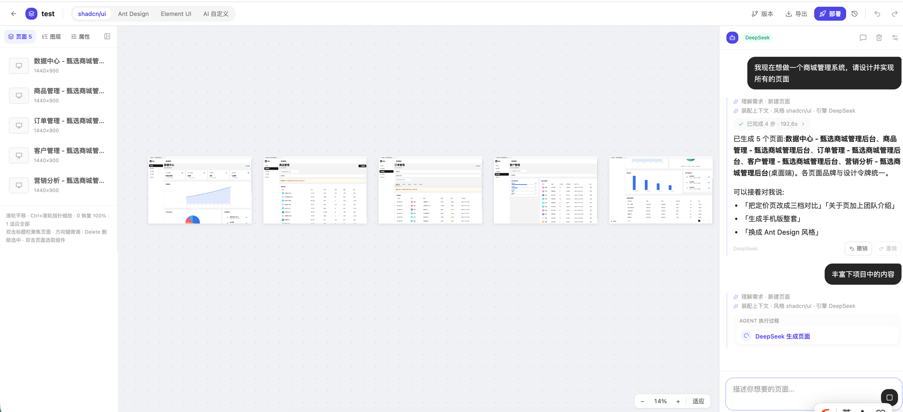

# owli-A2UI

AI 驱动的 **UI/UX Design Harness Agent** 工作台:自然语言驱动的多页面设计生成,具备完整的 Run 状态机、Proposal/Commit 隔离、专家评审门禁与工程交付能力。

## 核心能力

- **Harness Agent 管线**:Intake 理解 → 结构化澄清(HITL)→ 风格/Skill 路由 → 规划 → 生成 → 校验 → UX 评审 → Commit Gate(85/80,原型探索模式放宽至 70)→ 审批 → 原子提交 → 解释,全程 Run 状态机(19 态)与事件流可观测;执行时间线以结构化工具卡呈现各阶段耗时与 token 增量
- **工具系统(ToolRuntime)**:15 个具名工具(只读上下文/Proposal/校验评审/事务/工程)统一契约——zod 校验、权限矩阵、超时、字节上限、span 与审计;`commit_ops` 仅 Orchestrator 可调
- **Plan 任务操作(§14.3)**:计划确认卡(可编辑/跳过/删除任务)、执行中暂停/恢复闸门、逐任务跳过并注入生成上下文;HITL 审批/澄清/计划确认均带可见倒计时
- **设计模式库与项目记忆(§10.4/10.5)**:内置设计模式检索注入规划提示词;用户确认后的长期偏好(密度/语气/色彩/禁用项)跨会话生效
- **Design IR 单一事实源**:页面/组件以 IR 描述,支持 baseRevision 乐观锁、OpsBatch 差分、逆运算撤销、快照回滚
- **流式体验**:逐 token 生成 + 半截 JSON 容错解析,画布幻影画框/就地预览渐进渲染,Agent 面板原始输出打字机;增量 delta 帧不落库
- **工程交付**:IR → 可构建 React 工程(静态 Tailwind / Ant Design / shadcn 组件包)与 Vue 3 SFC 工程(experimental);完整构建门禁(tsc --noEmit → vite build;Vue 跳过 tsc)异步校验后下载
- **UI 库适配器矩阵(§23.3)**:shadcn/antd(stable)+ element/mui/mantine(beta/experimental)+ vue3,兼容矩阵驱动导出选择与降级说明
- **TSX 导入**:React TSX → Design IR 反向解析,未映射项逐个标记
- **模板库**:项目存为模板(含封面缩略图),市场分类浏览、一键应用
- **组件定义/实例**:子树定义为可复用组件,实例插入画布自动展开
- **Skill 体系(§24)**:14 个内置 Skill(关键词/意图路由,每 Run ≤3)+ 第三方市场(沙箱校验 + 审核流)+ 触发评测集(准确率/误触发校准)
- **协作**:RBAC(owner/editor/viewer)+ 成员管理 + 页面/元素评论 + presence 在线状态
- **治理**:预算/配额(token/成本/工具调用数/时长)、OTEL 观测、审计日志、站内告警
- **多模型路由**:按阶段(规划/生成/评审)配置不同模型

## 预览



## 技术栈

- **前端**:React 19 + TypeScript + Vite + Tailwind CSS + zustand + tRPC
- **后端**:Hono + tRPC 11 + Drizzle ORM + SQLite(better-sqlite3)
- **AI**:OpenAI 兼容协议(DeepSeek / Kimi 等)
- **质量**:vitest(166 tests)+ puppeteer E2E(14 项)+ esbuild 语法门禁 + tsc 类型门禁 + 视觉回归(4 基线)

## 快速开始

```bash
cd app
npm install
npm run dev          # 开发:工作台 + API
```

## 工程命令

```bash
npm run check        # TypeScript 全量类型检查
npm test             # 单元/集成测试(136+)
npm run lint         # ESLint
npm run build        # 生产构建(前端 + API bundle)
npm run e2e          # E2E 主流程(需先启动服务;--full 追加 LLM 链路)
npm run backup       # 备份(SQLite 在线备份 + 部署/导出产物)
npm run restore      # 恢复(还原前自动保底)
EVALS_LLM=1 npm test -- api/evals/evals.llm.test.ts   # 评测集全量回归(需 LLM Key)
```

## 架构与文档

- 《A2UI 专家级 UI/UX Design Harness Agent 生产级设计实现方案》—— 总体设计
- 《A2UI 前端工作台详细设计》—— 工作台交互设计
- 《A2UI 剩余功能与后续演进计划》—— 交付状态与演进项(v1.7:全部收官)

## 项目结构

```
app/
├── api/
│   ├── agent/         # Run 状态机 / RunManager / 专家管线 / 评审 / 门禁 / 预算
│   ├── command/       # Command Service(IR 原子提交 / 逆运算 / 回滚)
│   ├── export/        # Codegen / 运行时模板 / 构建门禁 / 任务队列
│   ├── import/        # TSX Importer
│   ├── evals/         # 评测集(30 组用例 + 确定性判卷)
│   ├── observability/ # OTEL 轻量追踪
│   ├── routers/       # tRPC 路由(项目/页面/Runs/导出/模板/评论/成员/…)
│   └── llm/           # LLM 适配(流式 / 提示词 / 预算放大)
├── src/               # 工作台前端(Agent 面板 / 画布 / 渲染器 / 面板)
├── contracts/         # 共享契约(A2UI 协议 / Design IR / Agent 事件)
├── db/                # Drizzle Schema + DDL 自举
└── scripts/           # 迁移 / 备份 / E2E 脚本
```
